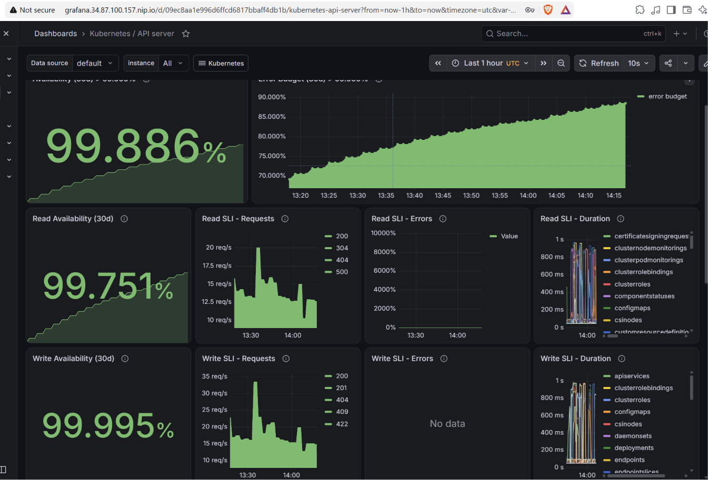
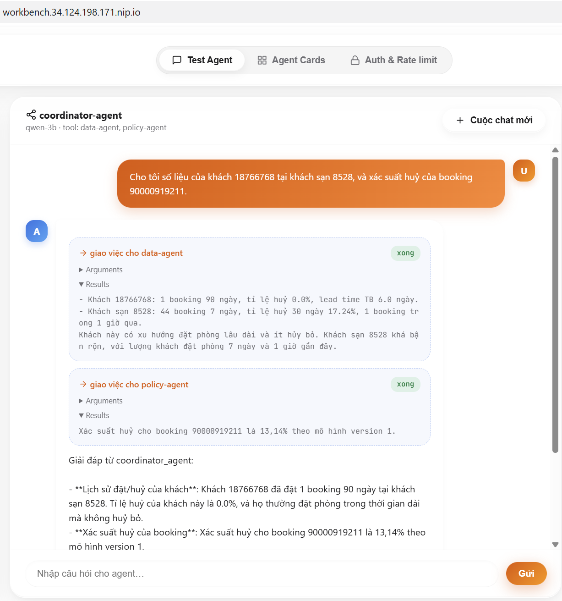
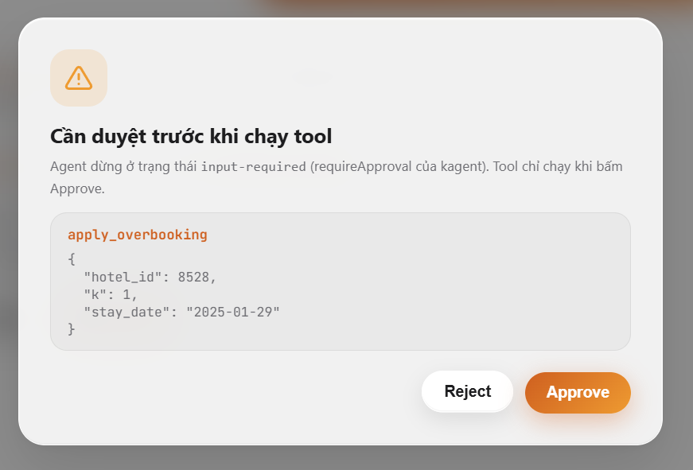
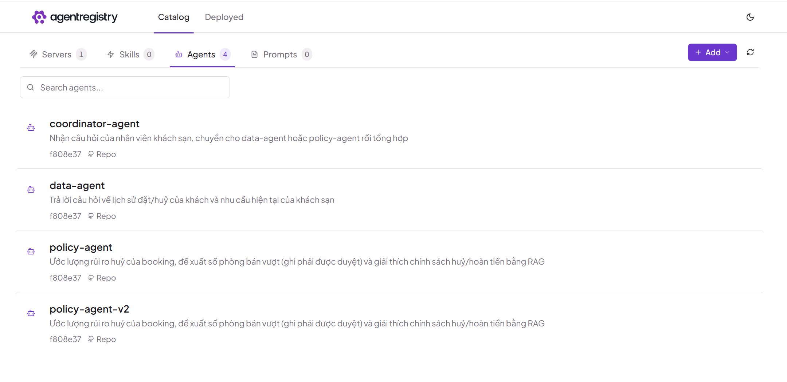
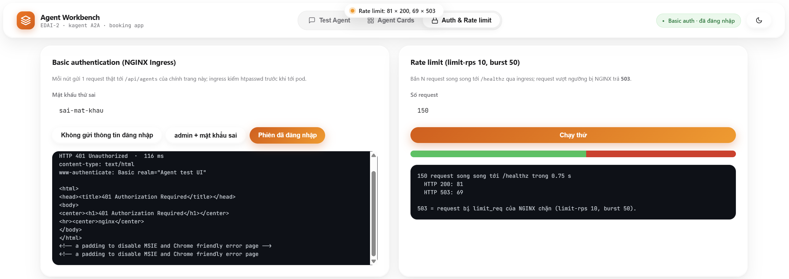

# Routing & gateway (NGINX Ingress)

Service được đặt sau ingress, có basic auth, rate limit, domain và HTTPS.

Mỗi mục ứng với một dòng của rubric. Mục đã hoàn thành ghi lại phần đã triển khai và kết quả (số liệu đo được,
ảnh chụp trong `docs/images/`). Mục chưa hoàn thành giữ trích rubric, phần **Cách làm** đồng bộ từ cột F của rubric
và phần **Kết quả** chờ bổ sung.

## Service để coi metric · edai-2 · External Routing & Gateway (NGINX Ingress Controll

NGINX Ingress Controller 4.15.1 (LoadBalancer `34.87.100.157`, `loadBalancerSourceRanges` chỉ mở cho IP của nhóm) và Ingress `observability` trong `k8s/ingress.yaml`, chạy trên GKE ngày 2026-11-18. Host `grafana.booking.local` trỏ vào service `kube-prometheus-stack-grafana:80`; service không mở port ra ngoài mà chỉ đi qua
ingress.

`curl -H "Host: grafana.booking.local" http://34.87.100.157/` trả 302 (chuyển tới trang đăng nhập).

## Service để coi log · edai-2 · External Routing & Gateway (NGINX Ingress Controll

NGINX Ingress Controller 4.15.1 (LoadBalancer `34.87.100.157`, `loadBalancerSourceRanges` chỉ mở cho IP của nhóm) và Ingress `observability` trong `k8s/ingress.yaml`, chạy trên GKE ngày 2026-11-18. Host `kibana.booking.local` trỏ vào service `kibana-kibana:5601`; service không mở port ra ngoài mà chỉ đi qua
ingress.

`curl -H "Host: kibana.booking.local" http://34.87.100.157/` trả 302 (chuyển tới trang đăng nhập).

## Service để coi trace · edai-2 · External Routing & Gateway (NGINX Ingress Controll

NGINX Ingress Controller 4.15.1 (LoadBalancer `34.87.100.157`, `loadBalancerSourceRanges` chỉ mở cho IP của nhóm) và Ingress `observability` trong `k8s/ingress.yaml`, chạy trên GKE ngày 2026-11-18. Host `jaeger.booking.local` trỏ vào service `jaeger-query:16686`; service không mở port ra ngoài mà chỉ đi qua
ingress.

`curl -H "Host: jaeger.booking.local" http://34.87.100.157/` trả 200.

## UI để test agent

Agent Workbench ([`ui/index.html`](../../edai2/ui/index.html), [`ui/nginx.conf`](../../edai2/ui/nginx.conf),
[`k8s/agent-workbench.yaml`](../../edai2/k8s/agent-workbench.yaml)) là trang tĩnh chạy trên nginx trong namespace
`kagent`, đứng sau NGINX Ingress tại `workbench.34.124.198.171.nip.io` (chỉ mở cho IP của nhóm). Pod workbench không
gọi model hay MCP trực tiếp: nginx proxy `/api/` sang kagent controller, trang gửi `message/send` theo giao thức A2A tới
`/api/a2a/kagent/<agent>/`. Mọi số liệu trên trang lấy từ task A2A trả về: lời gọi tool và agent con (kèm Arguments,
Results) từ `history`, câu trả lời từ `artifacts`, token từ `kagent_usage_metadata`; thời gian phản hồi đo ở trình duyệt.
kagent UI gốc cũng được đặt sau ingress tại `agents.34.124.198.171.nip.io` với cùng lớp xác thực.

Thử trên cluster thứ hai ngày 2026-11-19:

- coordinator-agent nhận câu hỏi về khách 18766768, khách sạn 8528 và booking 90000919211, giao việc cho data-agent và
  policy-agent rồi tổng hợp đúng số liệu (1 booking 90 ngày, tỉ lệ huỷ 0%; xác suất huỷ 13,14%, model v1).
- policy-agent với câu "Đồng ý, áp dụng K=1 cho khách sạn 8528 đêm 2025-01-29": task dừng ở `input-required`, trang mở
  hộp duyệt với tham số của `apply_overbooking`; nút Approve/Reject gửi `decision_type` của kagent. Bấm Reject thì tool trả
  "Tool call was rejected by user" và `gold.overbooking_limits` không có lần ghi mới.

## UI cho agent registry

UI của agentregistry (dòng 8) đứng sau NGINX Ingress `agentregistry` trong
[`k8s/ingress.yaml`](../../edai2/k8s/ingress.yaml), host `registry.34.124.198.171.nip.io`, cùng lớp bảo vệ với UI test
agent: basic auth bằng Secret htpasswd `kagent-ui-auth` (bản sao trong namespace `agentregistry`) và `limit-rps` 10.
Service `agentregistry` chỉ là ClusterIP. Kiểm ngày 2026-11-19: không đăng nhập trả 401, đăng nhập trả 200, API
`/v0/agents` qua ingress trả đủ 4 agent.

## Setup authentication cho UI test agent ở trên

Ingress `agent-workbench` ([`k8s/agent-workbench.yaml`](../../edai2/k8s/agent-workbench.yaml)) và `kagent-ui`
([`k8s/ingress.yaml`](../../edai2/k8s/ingress.yaml)) dùng `auth-type: basic` với Secret htpasswd `kagent-ui-auth`
(user `admin`, mật khẩu ngẫu nhiên lưu ngoài repo) và `limit-rps: "10"`; NGINX sinh `limit_req rate=10r/s burst=50`,
request vượt ngưỡng nhận 503 (`limit_req_status` mặc định của ingress-nginx).

Tab *Auth & Rate limit* của Agent Workbench gửi request thật qua ingress, kết quả ngày 2026-11-19:

- `GET /api/agents` không kèm thông tin đăng nhập hoặc với mật khẩu sai: `401 Unauthorized`, header
  `WWW-Authenticate: Basic realm="Agent test UI"`; với phiên đã đăng nhập: 200.
- 150 request song song tới `/healthz` trong 0,75 s: 81 request nhận 200, 69 request bị chặn với 503.

Đo thêm bằng curl từ máy của nhóm: 300 request song song tới kagent UI cho 112 × 200 và 188 × 503.

## Làm cái này cho Web API kéo dữ liệu · edai-2 · External Routing & Gateway (NGINX Ingress Controll

**Rubric:** edai-2 · dòng 43 · 1 điểm · nhóm *External Routing & Gateway (NGINX Ingress Controller)* › *Setup domain & enable HTTPS*

> Làm cái này cho Web API kéo dữ liệu. Mọi người có thể tham khảo 2 đồ án sau: cái này và cái này

**Cách làm:** [Đã có] cert-manager cấp chứng chỉ Let's Encrypt cho `api.booking.example.com`. [Cần làm] cần domain thật trỏ về ingress; chụp chứng chỉ hợp lệ.

**Kết quả:** _Chưa có. Cần số liệu, ảnh chụp hoặc link code sau khi chạy trên cluster._
