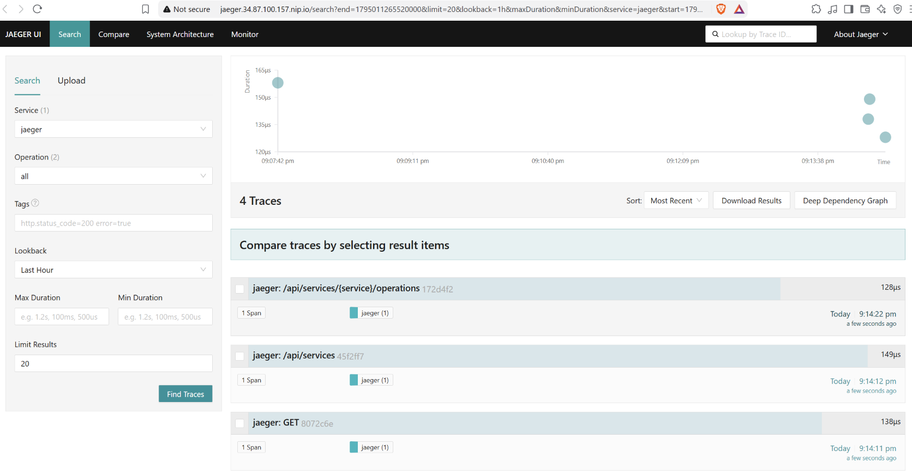
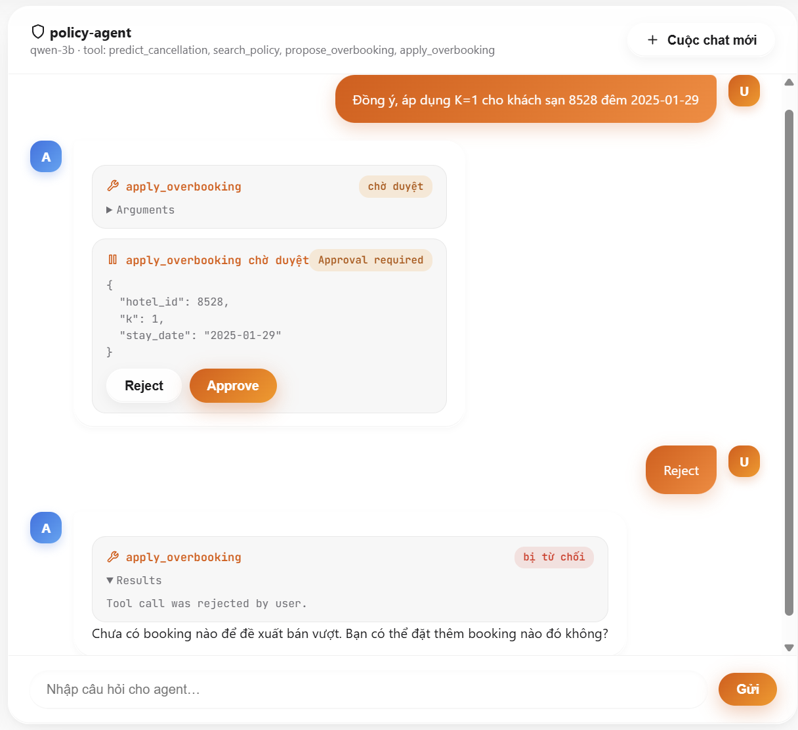
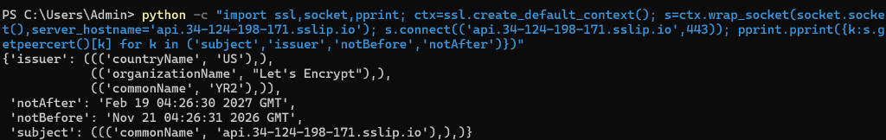
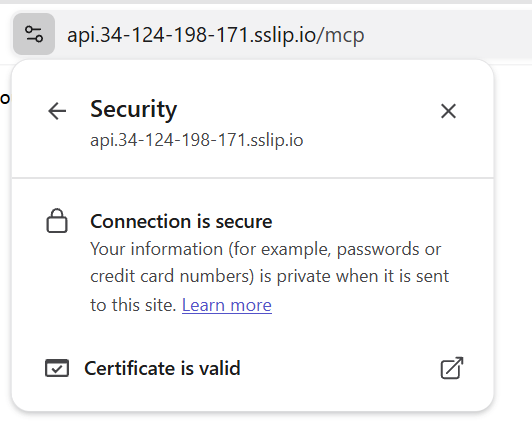
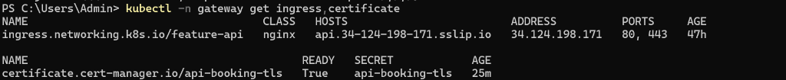

# Routing & gateway (NGINX Ingress)

Các dịch vụ nội bộ được đưa ra ngoài qua NGINX Ingress với basic auth, rate limit, domain và HTTPS.

## Ingress cho Grafana (Metrics)

NGINX Ingress Controller 4.15.1 (LoadBalancer `34.87.100.157`, giới hạn IP qua `loadBalancerSourceRanges`) và Ingress `observability` trong `k8s/ingress.yaml` đưa `kube-prometheus-stack-grafana:80` qua host `grafana.booking.local` (chỉ truy cập qua ingress, không mở port trực tiếp). Kiểm tra `curl -H "Host: grafana.booking.local" http://34.87.100.157/` trả `302` tới trang đăng nhập.

*Chú thích: Truy cập giao diện Grafana an toàn thông qua NGINX Ingress (`grafana.booking.local`), thay vì mở port trực tiếp từ pod.*

## Ingress cho Kibana (Logs)

Host `kibana.booking.local` trên cùng Ingress `observability` trỏ vào service `kibana-kibana:5601`. Kiểm tra `curl -H "Host: kibana.booking.local" http://34.87.100.157/` trả `302` tới trang đăng nhập.

*Chú thích: Truy cập giao diện Kibana thông qua NGINX Ingress (`kibana.booking.local`) để tra cứu log tập trung.*

## Ingress cho Jaeger (Traces)

Host `jaeger.booking.local` trên Ingress `observability` trỏ vào service `jaeger-query:16686`. Kiểm tra `curl -H "Host: jaeger.booking.local" http://34.87.100.157/` trả `200`.

*Chú thích: Truy cập giao diện Jaeger UI thông qua NGINX Ingress (`jaeger.booking.local`) để xem trace phân tán.*

## Giao diện kiểm thử Agent (Agent Workbench & kagent UI)

Agent Workbench ([`ui/index.html`](../../edai2/ui/index.html), [`ui/nginx.conf`](../../edai2/ui/nginx.conf),
[`k8s/agent-workbench.yaml`](../../edai2/k8s/agent-workbench.yaml)) là trang tĩnh chạy trên nginx trong namespace
`kagent`, đứng sau NGINX Ingress tại `workbench.34.124.198.171.nip.io` (chỉ mở cho IP của nhóm). Pod workbench không
gọi model hay MCP trực tiếp: nginx proxy `/api/` sang kagent controller, trang gửi `message/send` theo giao thức A2A tới
`/api/a2a/kagent/<agent>/`. Mọi số liệu trên trang lấy từ task A2A trả về: lời gọi tool và agent con (kèm Arguments,
Results) từ `history`, câu trả lời từ `artifacts`, token từ `kagent_usage_metadata`; thời gian phản hồi đo ở trình duyệt.
kagent UI gốc cũng được đặt sau ingress tại `agents.34.124.198.171.nip.io` với cùng lớp xác thực.

Thử trên GKE:

- coordinator-agent nhận câu hỏi về khách 18766768, khách sạn 8528 và booking 90000919211, giao việc cho data-agent và
  policy-agent rồi tổng hợp đúng số liệu (1 booking 90 ngày, tỉ lệ huỷ 0%; xác suất huỷ 13,14%, model v1).
- policy-agent với câu "Đồng ý, áp dụng K=1 cho khách sạn 8528 đêm 2025-01-29": task dừng ở `input-required`, trang mở
  hộp duyệt với tham số của `apply_overbooking`; nút Approve/Reject gửi `decision_type` của kagent. Bấm Reject thì tool trả
  "Tool call was rejected by user" và `gold.overbooking_limits` không có lần ghi mới.

*Chú thích: Agent Workbench cho thấy `coordinator-agent` nhận câu hỏi hỗn hợp, gọi tuần tự `data-agent` và `policy-agent`, hiển thị rõ Arguments, Results và số liệu tổng hợp.*

*Chú thích: Hộp thoại duyệt HITL trên Agent Workbench khi `policy-agent` gọi `apply_overbooking`: task tạm dừng ở `input-required`, hiện rõ `hotel_id`, `stay_date`, `k` cùng 2 nút `Approve` / `Reject`.*

*Chú thích: Khi bấm `Reject` trên hộp thoại HITL của Agent Workbench, tool trả về `'Tool call was rejected by user'` và bảng `gold.overbooking_limits` không bị ghi dữ liệu mới.*

## Giao diện Agent Registry qua Ingress

UI của agentregistry đứng sau NGINX Ingress `agentregistry` trong
[`k8s/ingress.yaml`](../../edai2/k8s/ingress.yaml), host `registry.34.124.198.171.nip.io`, cùng lớp bảo vệ với UI test
agent: basic auth bằng Secret htpasswd `kagent-ui-auth` (bản sao trong namespace `agentregistry`) và `limit-rps` 10.
Service `agentregistry` chỉ là ClusterIP. Kiểm: không đăng nhập trả 401, đăng nhập trả 200, API
`/v0/agents` qua ingress trả đủ 4 agent.

*Chú thích: Giao diện web `agentregistry` hiển thị đủ catalog 4 Agent (`coordinator-agent`, `data-agent`, `policy-agent`, `policy-agent-v2`) kèm tag commit git.*

## Xác thực Basic Auth và Rate Limit cho UI

Ingress `agent-workbench` ([`k8s/agent-workbench.yaml`](../../edai2/k8s/agent-workbench.yaml)) và `kagent-ui`
([`k8s/ingress.yaml`](../../edai2/k8s/ingress.yaml)) dùng `auth-type: basic` với Secret htpasswd `kagent-ui-auth`
(user `admin`, mật khẩu ngẫu nhiên lưu ngoài repo) và `limit-rps: "10"`; NGINX sinh `limit_req rate=10r/s burst=50`,
request vượt ngưỡng nhận 503 (`limit_req_status` mặc định của ingress-nginx).

Tab *Auth & Rate limit* của Agent Workbench gửi request thật qua ingress, kết quả:

- `GET /api/agents` không kèm thông tin đăng nhập hoặc với mật khẩu sai: `401 Unauthorized`, header
  `WWW-Authenticate: Basic realm="Agent test UI"`; với phiên đã đăng nhập: 200.
- 150 request song song tới `/healthz` trong 0,75 s: 81 request nhận 200, 69 request bị chặn với 503.

Đo thêm bằng curl từ máy của nhóm: 300 request song song tới kagent UI cho 112 × 200 và 188 × 503.

*Chú thích: Tab "Auth & Rate limit" trên Agent Workbench: gửi request không mật khẩu trả `401 Unauthorized`; bắn 150 request song song trong 0,75 s cho 81 mã `200` và 69 mã `503` (bị rate limit `10 req/s`).*

## Domain & HTTPS cho Web API (agentgateway)

[`cert-issuer.yaml`](../../edai2/k8s/cert-issuer.yaml) cấu hình `ClusterIssuer` `letsencrypt-prod` (ACME HTTP-01 qua `nginx`), kết hợp Ingress `feature-api` trong [`ingress.yaml`](../../edai2/k8s/ingress.yaml) gắn domain `api.34-124-198-171.sslip.io` trỏ về `agentgateway:3000` (cổng `/mcp` và `/v1`) với secret TLS `api-booking-tls`.

Trên GKE, `cert-manager` cấp thành công chứng chỉ **Let's Encrypt (`YR2`)** cho `api.34-124-198-171.sslip.io` (`certificate/api-booking-tls` `READY = True`, hiệu lực `2026-11-21` → `2027-02-19`). Kiểm tra trực tiếp bằng Python `ssl` và `curl.exe -sI https://api.34-124-198-171.sslip.io/mcp` (không dùng `-k`): TLS bắt tay thành công với chuỗi tin cậy hợp lệ và `agentgateway` trả `401 Unauthorized` (`no bearer token found`), chứng tỏ luồng HTTPS đã thông suốt tới gateway.

*Chú thích: Kiểm tra bằng Python `ssl` và `curl.exe -sI https://api.34-124-198-171.sslip.io/mcp` (không dùng `-k`): bắt tay TLS thành công với chứng chỉ Let's Encrypt thật và gateway trả `401` yêu cầu Bearer token.*

*Chú thích: Trình duyệt xác nhận `Connection is secure` và `Certificate is valid` do Let's Encrypt (`YR2`) cấp cho `api.34-124-198-171.sslip.io`.*

*Chú thích: Output `kubectl` cho thấy Ingress `feature-api` và `Certificate/api-booking-tls` ở trạng thái `READY=True` (hiệu lực `2026-11-21` → `2027-02-19`).*
