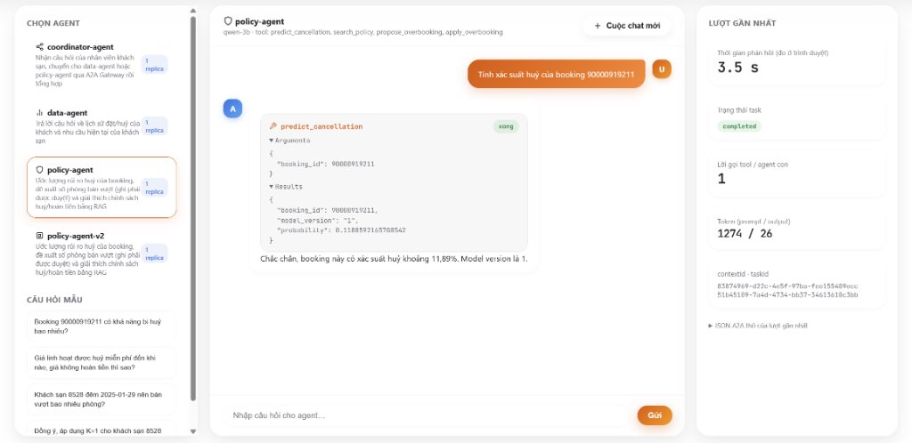
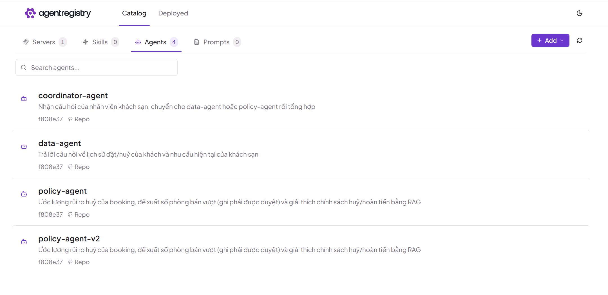
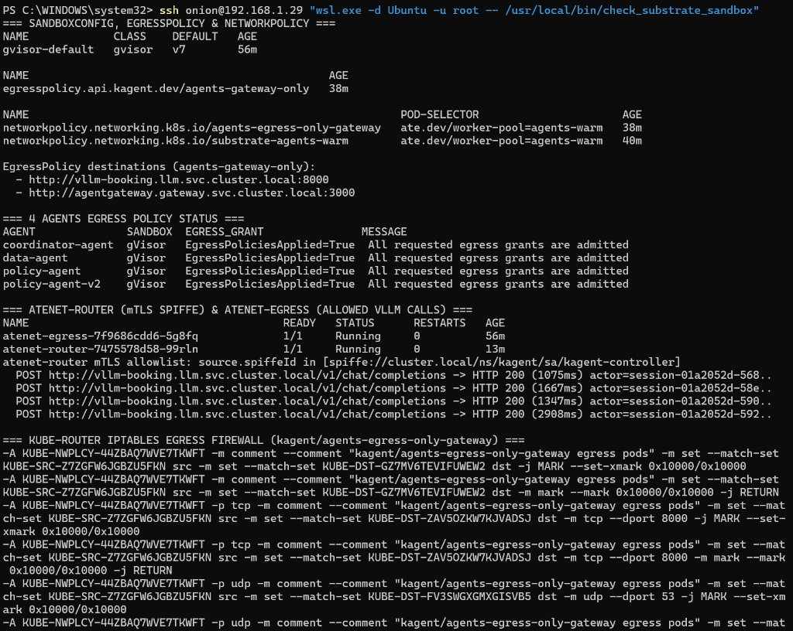

# Agent thứ hai: policy-agent

Agent thứ hai dùng tool ML (`predict_cancellation`: Feast online + KServe) và tool RAG (`search_policy`).

## policy-agent (Feast + KServe + RAG + HITL)

`policy-agent` ([`agents/agents-gke.yaml`](../../edai2/agents/agents-gke.yaml)) được triển khai trên cluster GKE với 4 tool đi qua `agentgateway` (`RemoteMCPServer` `booking-tools-policy`, token role `policy-agent`), chạy 2 replica, autoscale 2–4 bằng KEDA và đã đăng ký lên `agentregistry`.

Kết quả kiểm thử qua A2A và kagent UI:
- `predict_cancellation(90000919211)`: đọc feature từ Feast online + KServe, trả về xác suất huỷ `13,14%` (`model_version: 1`).
- `search_policy`: truy xuất đoạn `policies/cancellation.md#0` từ online store (bge-m3), trả lời đúng mốc huỷ miễn phí 18:00 ngày trước nhận phòng của giá linh hoạt và điều kiện hoàn tiền.
- `propose_overbooking(8528, 2025-01-29)`: tính toán trên 2 booking đang giữ phòng và 15 phòng trống, đề xuất `K = 0` (điểm rủi ro trong `gold.booking_risk` được chấm qua `/v1/cancel-risk/batch`).
- `apply_overbooking`: gắn cờ `requireApproval` để yêu cầu người duyệt trước khi ghi DB.

Trong quá trình chạy đã khắc phục 2 lỗi thực tế: thiết lập `HF_HOME=/tmp/hf` trong `helm/api/values-booking-mcp.yaml` để `booking-mcp` ghi được cache bge-m3, và nâng ngữ cảnh vLLM từ `2048` lên `4096` để chứa đủ 4 chunk 512 token. Model 3B chọn đúng tool cho các câu hỏi kiểm thử, dù đôi lúc vẫn cần cải thiện độ chính xác khi diễn giải lại số liệu từ tool.

Cả `policy-agent` và `policy-agent-v2` đã được triển khai thực tế trong sandbox gVisor (`SandboxConfig/gvisor-default`) qua **kagent 1.0.1 + Agent Substrate** tại [agent-substrate-v1.yaml](../../edai2/k8s/agent-substrate-v1.yaml). Cả hai agent đều đạt `Ready=True` (`ActorTemplate golden snapshot is ready`), `EgressPoliciesApplied=True` theo `EgressPolicy/agents-gateway-only`, dùng `ModelConfig/vllm-booking-config` và chia sẻ chung `WorkerPool/agents-warm`.

