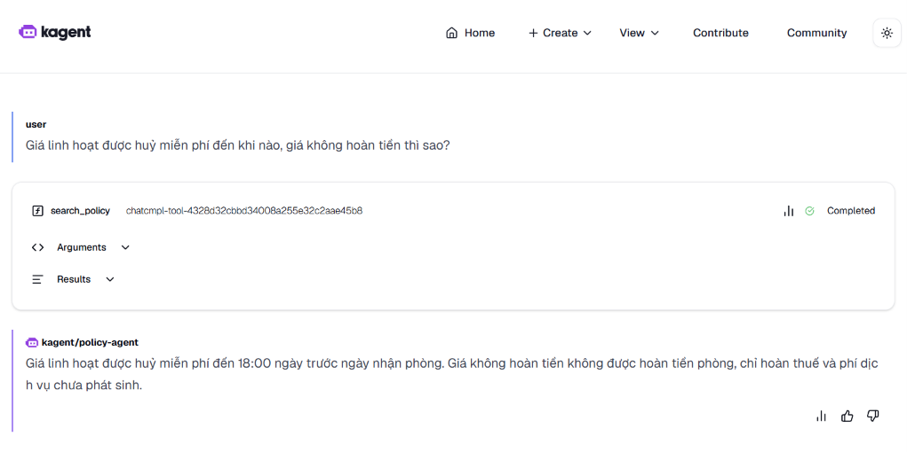

# Agent thứ hai: policy-agent

Agent thứ hai dùng tool ML (`predict_cancellation`: Feast online + KServe) và tool RAG (`search_policy`).

Mỗi mục dưới đây ứng với một dòng của rubric. Phần **Cách làm** mô tả giải pháp đã triển khai, đồng bộ từ
cột F của rubric. Phần **Kết quả** ghi test đã chạy, số liệu đo được hoặc ảnh chụp (`docs/images/`).

## Làm tương tự, thêm 1 Agent nhận dữ liệu từ Online Feature Store, và có 2 tools:

**Rubric:** edai-2 · dòng 22 · 8 điểm · nhóm *Làm tương tự, thêm 1 Agent nhận dữ liệu từ Online Feature Store, và có 2 tools:*

**Cần nộp (cả nhóm):** Document tương tự bên trên

**Cách làm:** [Đã có] policy-agent có bốn tool: `predict_cancellation` (ML, Feast online + KServe), `search_policy` (RAG), `propose_overbooking` (K tính từ `gold.booking_risk`, so với số phòng trong `gold.hotel_rooms`) và `apply_overbooking` (ghi K, cần `requireApproval` - Idea 2). [Cần làm] multi-replica, KEDA, Agent Substrate (sandbox), registry; chụp UI chat.

**Kết quả:** policy-agent chạy trên cluster thứ hai ngày 2026-11-19 với đủ bốn tool
([`agents/agents-gke.yaml`](../../edai2/agents/agents-gke.yaml)); multi-replica, KEDA, sandbox và registry chưa
làm. Kết quả gọi thử qua A2A và kagent UI:

- `predict_cancellation(90000919211)`: Feast online + KServe trả xác suất huỷ 13,14%, `model_version` 1.
- `search_policy`: lấy đoạn `policies/cancellation.md#0` từ online store (15 chunk, bge-m3); câu trả lời nêu đúng mốc
  huỷ miễn phí 18:00 ngày trước nhận phòng của giá linh hoạt và mức hoàn của giá không hoàn tiền.
- `propose_overbooking(8528, 2025-01-29)`: 2 booking đang giữ phòng, 15 phòng, K = 0. Điểm trong `gold.booking_risk`
  được chấm qua `/v1/cancel-risk/batch` theo đúng truy vấn của DAG `score_bookings` (2/6 booking đã có trên online store).

Hai lỗi lộ ra khi chạy và đã sửa: booking-mcp không ghi được cache của bge-m3 vì user `app` không có thư mục home
(đặt `HF_HOME=/tmp/hf` trong `helm/api/values-booking-mcp.yaml`), và bốn chunk 512 token vượt ngữ cảnh 2048 của vLLM
(nâng lên 4096). Model 3B chọn tool đúng với các câu hỏi trên nhưng có lúc diễn giải sai số liệu tool trả về.

