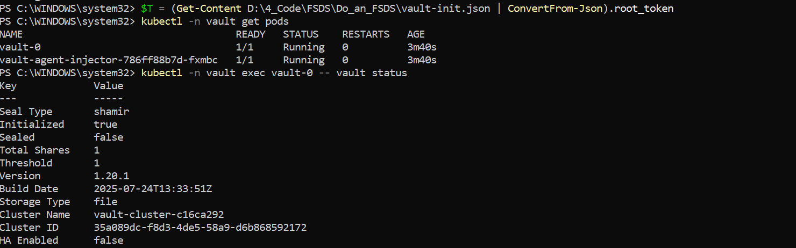
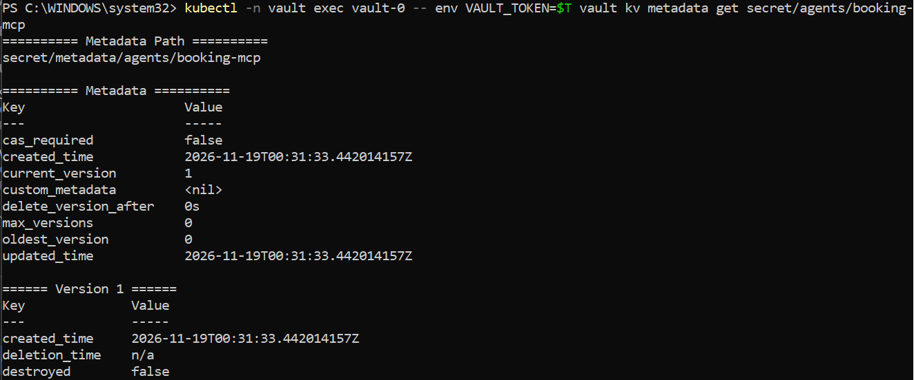
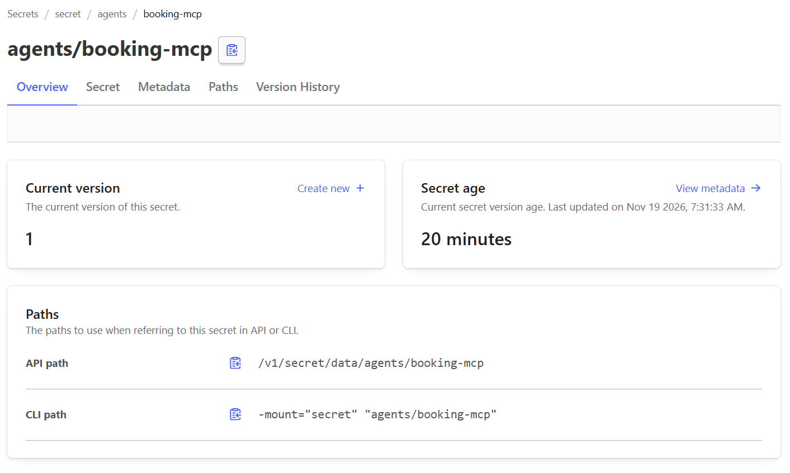
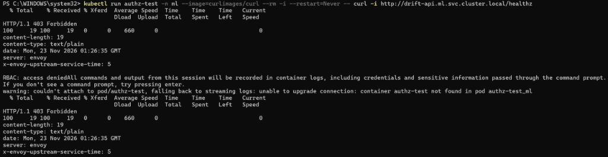

# Security

Quản lý secret tập trung bằng HashiCorp Vault.

## Quản lý secret tập trung với HashiCorp Vault

Vault 1.20.1 cài bằng Helm trên GKE kèm Vault Agent Injector (cấu hình tại [`edai2/k8s/vault-values.yaml`](../../edai2/k8s/vault-values.yaml)). Script [`edai2/k8s/vault-setup.sh`](../../edai2/k8s/vault-setup.sh) khởi tạo KV v2, bật xác thực Kubernetes và cấp cho `booking-mcp` policy chỉ đọc (`read`) trên đúng đường dẫn secret của nó.

Toàn bộ secret của `booking-mcp` (DSN warehouse, Feast, OTLP) được chuyển từ Kubernetes Secret sang Vault và bơm tự động vào pod qua Vault Agent Injector. Sau khi xoá Kubernetes Secret cũ (`booking-mcp-env`), pod vẫn `Ready` và **12/12** lời gọi MCP/REST thành công.

*Chú thích: Output `kubectl` và `vault status` trên GKE xác nhận pod `vault-0` đang chạy và đã được unseal (`Sealed: false`).*

*Chú thích: Output `vault kv metadata get secret/agents/booking-mcp`: xác nhận đường dẫn secret tồn tại trên Vault mà không làm lộ giá trị mật khẩu ra terminal.*

*Chú thích: Kiểm tra policy `booking-mcp` (chỉ có quyền `read` trên đúng `secret/data/agents/booking-mcp`) và role Kubernetes gắn với ServiceAccount `booking-mcp`.*

*Chú thích: Kiểm tra pod `booking-mcp`: đã được bơm sidecar `vault-agent` để đọc secret từ Vault, đồng thời xác nhận Kubernetes Secret cũ `booking-mcp-env` đã bị xoá.*

*Chú thích: Giao diện web Vault UI hiển thị danh mục secret `secret/agents/booking-mcp` được quản lý tập trung.*

## Service-to-service mTLS & AuthorizationPolicy (Istio)

Namespace `ml` bật `istio-injection=enabled`, áp dụng [`edai2/k8s/istio-authz.yaml`](../../edai2/k8s/istio-authz.yaml) (`PeerAuthentication` chế độ `STRICT` và `AuthorizationPolicy` chỉ cho `knative-eventing` gọi `drift-api`, chỉ `agents/sa/booking-mcp` gọi `cancel-risk`). Khi gọi thử từ pod không được cấp quyền trong `ml`, Envoy trả **`HTTP/1.1 403 Forbidden`** (`RBAC: access denied`):

*Chú thích: Kiểm thử Istio `AuthorizationPolicy`: khi gọi tới `cancel-risk` hoặc `drift-api` từ một pod không có quyền trong namespace `ml`, Envoy sidecar chặn ngay với **`HTTP/1.1 403 Forbidden` (`RBAC: access denied`)**.*
