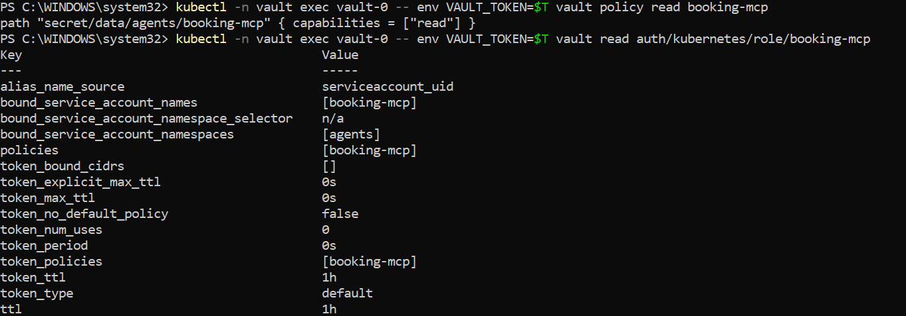
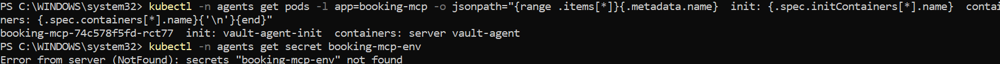

# Security

Vault quản lý secret; Istio bảo vệ giao tiếp giữa các service.

Mỗi mục ứng với một dòng của rubric, ghi lại phần đã triển khai và kết quả (số liệu đo được, ảnh chụp trong
`docs/images/`).

## Centralize secret management via Hashi Corp Vault so it will be used across the whole… · edai-2 · Security

Vault 1.20.1 cài bằng Helm trên GKE ngày 2026-11-19 (`edai2/k8s/vault-values.yaml`): 1 server standalone lưu file
trên PVC, kèm Vault Agent Injector. `edai2/k8s/vault-setup.sh` init và unseal lần đầu (khoá lưu ngoài repo), bật KV v2
tại `secret/`, bật xác thực Kubernetes, tạo policy `booking-mcp` chỉ có quyền `read` trên đúng path
`secret/data/agents/booking-mcp`, và role `booking-mcp` gắn với ServiceAccount `booking-mcp` của namespace `agents`.

Secret của booking-mcp (DSN warehouse, thông tin kết nối Feast, endpoint OTLP) chuyển từ Kubernetes Secret sang Vault.
Chart `helm/api` bật `vault.role`, nên Injector bơm init container `vault-agent-init` và sidecar `vault-agent` vào pod;
secret được ghi ra `/vault/secrets/env` và nạp lúc container khởi động. Sau khi chuyển, Kubernetes Secret
`booking-mcp-env` đã bị xoá: pod vẫn Ready, và 12/12 lời gọi thử (MCP tool và REST) thành công, tức booking-mcp chỉ còn
lấy secret từ Vault.

Phạm vi hiện mới là booking-mcp. Các service khác (MLflow, Job train, Postgres) vẫn dùng Kubernetes Secret; Jenkins lấy
secret qua `withVault` và token gateway đồng bộ bằng ExternalSecret chưa dựng lại trên cluster thứ hai. Bản standalone
một key share chưa có HA hay auto-unseal (cần Raft + GCP KMS khi dùng thật).

