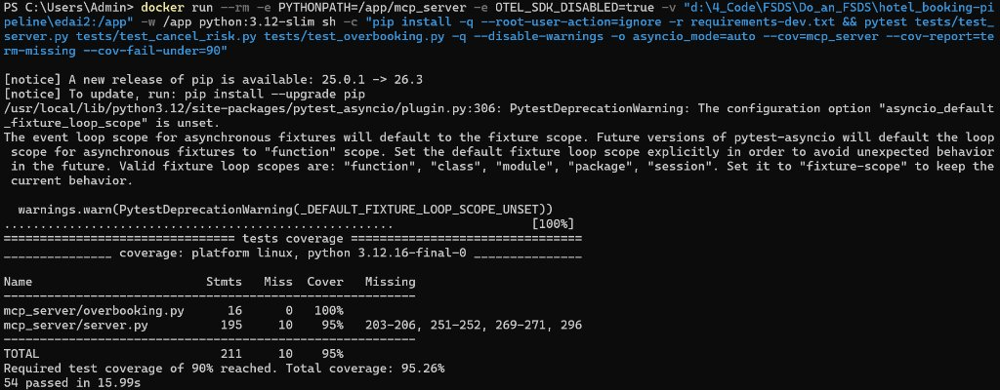
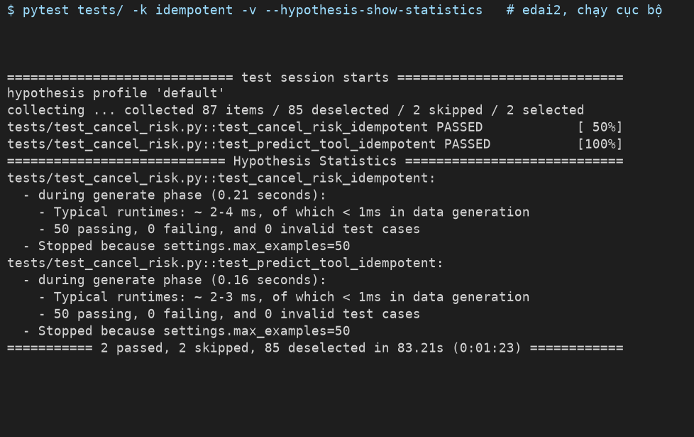
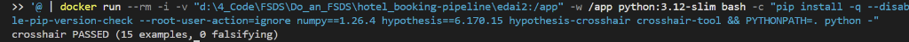
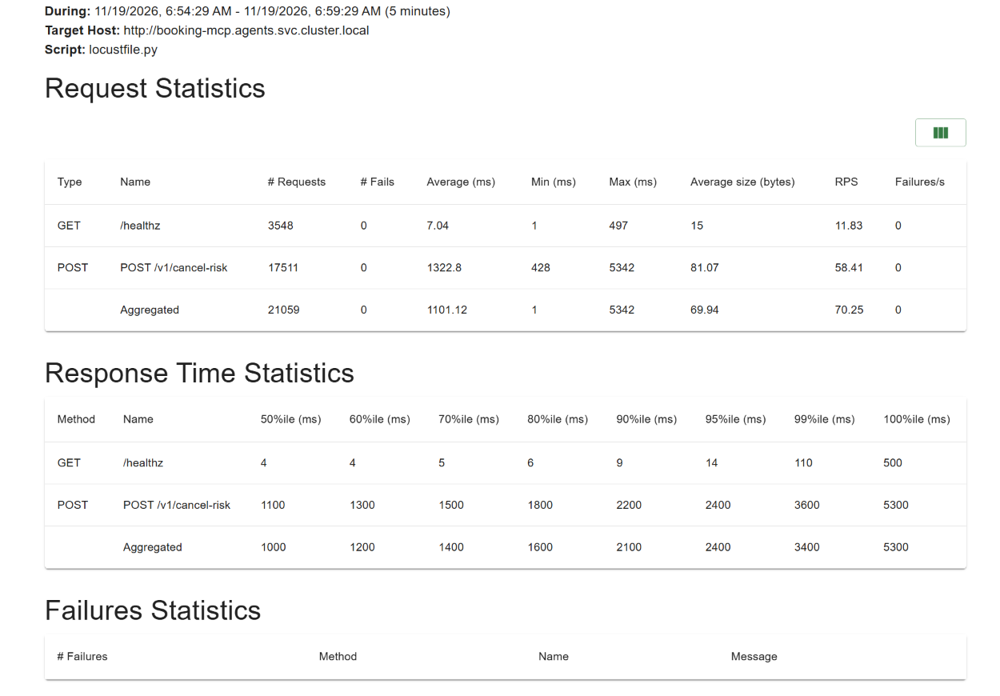
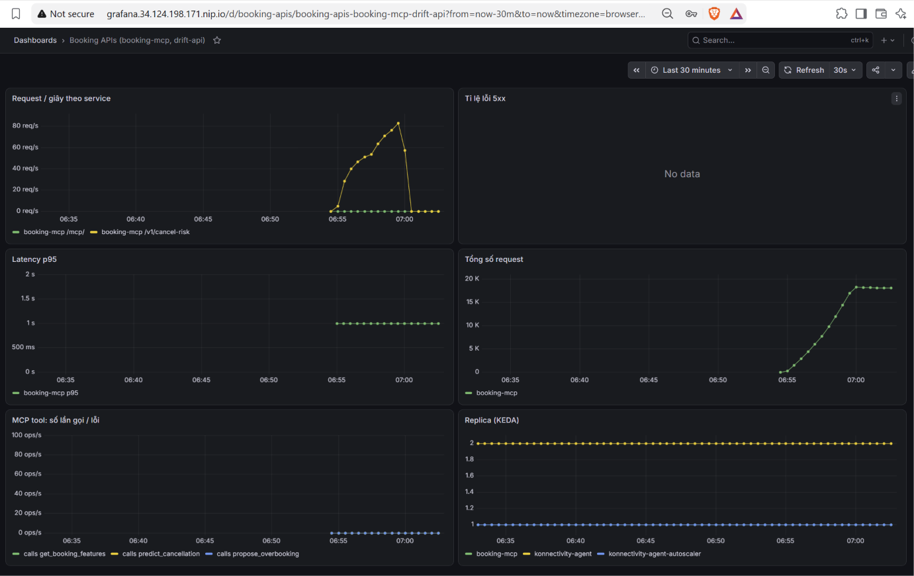

# Validation & verification

Unit test, phân lớp tương đương và giá trị biên (EP/BVA), mutation test, property-based test và load test.

## Unit test với Test Coverage > 90%

`edai2/tests/test_server.py` và `edai2/tests/test_cancel_risk.py` kiểm Web API của `booking-mcp` bằng fixture, monkeypatch và respx (giả Feast và KServe); `edai2/tests/test_overbooking.py` kiểm hàm tính `K`.

Chạy kiểm thử trong container (`python:3.12-slim`): `54` test đạt (`15,99 s`), tổng coverage `95,26%` (`mcp_server/server.py` `95%`, `mcp_server/overbooking.py` `100%`; trên Jenkins Build #19 toàn bộ suite đạt `79` test pass, coverage `96%`–`100%`).

## Thiết kế test theo Equivalence Partitioning & Boundary Value Analysis

Test tham số hoá theo các lớp tương đương và giá trị biên: xác suất trong `[0, 1]` trả về từ KServe, `booking_id`, và `K` (`p = 0` hoặc `1`, không có booking, chi phí `≤ 0`). `tests/test_overbooking.py` dùng Hypothesis để đối chiếu `K` với định nghĩa trực tiếp.

Các test `edai2/tests/test_overbooking.py` đều đạt trong lần chạy `54/54` ở trên (ảnh kết quả mục `#edai-2-28`) và trên Jenkins Build #19.

## Kiểm thử đột biến (Mutation Testing) với mutmut

Jenkins chạy mutmut chỉ trên các file thay đổi; `ci/check_mutation_score.py` chặn build khi score dưới
80%.

Mutmut chạy cục bộ trong container `python:3.12-slim` với `requirements-dev.txt`, chỉ mutate
`mcp_server/overbooking.py` (file có logic thay đổi gần nhất); bước này chưa chạy trong pipeline Jenkins. Trong 46 mutant,
test giết 40 và để sống 6, **mutation score đạt 87,0%** (ngưỡng 80%). Cả 6 mutant sống sót không làm đổi hành vi của `limit`:

- 2 mutant chỉ đổi chuỗi thông báo của `ValueError`.
- 2 mutant đổi epsilon `1e-12` thành `-1e-12` hoặc `2e-12`; mức chênh này quá nhỏ để làm đổi K.
- Mutant `len(probs) + 2` lấy thêm phần tử cuối của `below` (bằng 1). Hai chi phí đều dương nên `ratio` < 1, phần tử này
  không thoả điều kiện và kết quả giữ nguyên.
- Mutant thay `<=` bằng `<` chỉ khác khi `P(N < k)` bằng đúng `ratio + 1e-12`; bộ test không có trường hợp nào như vậy.

## Kiểm thử tính bất biến (Idempotency) với Hypothesis

Hypothesis kiểm hai property: `test_predict_tool_idempotent` (tool MCP) và `test_cancel_risk_idempotent`
(REST). Cùng một booking gọi hai lần phải cho cùng kết quả.

Chạy cục bộ (`pytest tests/ -k idempotent --hypothesis-show-statistics`): 2 test property
đều đạt, mỗi test 50 ví dụ do Hypothesis sinh (`booking_id` và xác suất KServe giả trả về trong [0, 1]), 0 ví dụ lỗi.
`test_cancel_risk_idempotent` gọi handler REST `cancel_risk` (`POST /v1/cancel-risk`) hai lần; `test_predict_tool_idempotent`
gọi tool MCP `predict_cancellation` hai lần cho cùng booking. Cả hai kiểm hai lần gọi cho cùng kết quả; Feast và KServe
được giả bằng respx.

Ngoài ra, kiểm thử symbolic execution bằng `hypothesis-crosshair` (`@settings(backend="crosshair", max_examples=15)`) cho hàm `limit` trong [`edai2/mcp_server/overbooking.py`](../../edai2/mcp_server/overbooking.py) đạt **15/15 ví dụ, 0 lỗi phản chứng** (`0 <= K <= rooms`).

## Kiểm thử tải (Load Test) Web API với Locust

`tests/locustfile.py` gửi tải tới `POST /v1/cancel-risk` (5 phần) và `/healthz` (1 phần) của booking-mcp; mỗi
request đọc feature từ Feast online rồi gọi KServe `cancel-risk`. Biến `BOOKING_IDS` cho locust dùng 5.000 `booking_id`
thật lấy từ `gold.fact_bookings`, vì cluster thứ hai chỉ có dữ liệu tháng 1/2025. Locust chạy trong một pod trên GKE,
gọi thẳng service: 100 user, tăng 10 user/s, 5 phút, `--html` ra file SLA
[locust_sla_report.html](locust_sla_report.html). booking-mcp chạy 1 replica.

| Endpoint | Request | Lỗi | RPS | p50 | p95 | p99 | Max |
|---|---|---|---|---|---|---|---|
| `POST /v1/cancel-risk` | 17.511 | 0 | 58,4 | 1.100 ms | 2.400 ms | 3.600 ms | 5.342 ms |
| `GET /healthz` | 3.548 | 0 | 11,8 | 4 ms | 14 ms | 110 ms | 497 ms |
| Tổng | 21.059 | 0 | 70,3 | 1.000 ms | 2.400 ms | 3.400 ms | 5.342 ms |

Không có request lỗi. Latency cao do đọc online store: trace Jaeger lúc chịu tải (dòng 15) cho thấy hai lần đọc Feast
chiếm khoảng 98% thời gian một request, còn KServe chỉ khoảng 7,5 ms. Hướng cải thiện: tăng replica booking-mcp, dùng
connection pool cho online store Feast, thêm index trên bảng online. Trên Grafana, req/s của `/v1/cancel-risk` lên tới
khoảng 80 req/s ở đỉnh và không có lỗi 5xx. Panel p95 đứng ở 1 s vì histogram mặc định của
`prometheus-fastapi-instrumentator` chỉ có bucket tới 1 s, nên p95 thật lấy theo locust.

