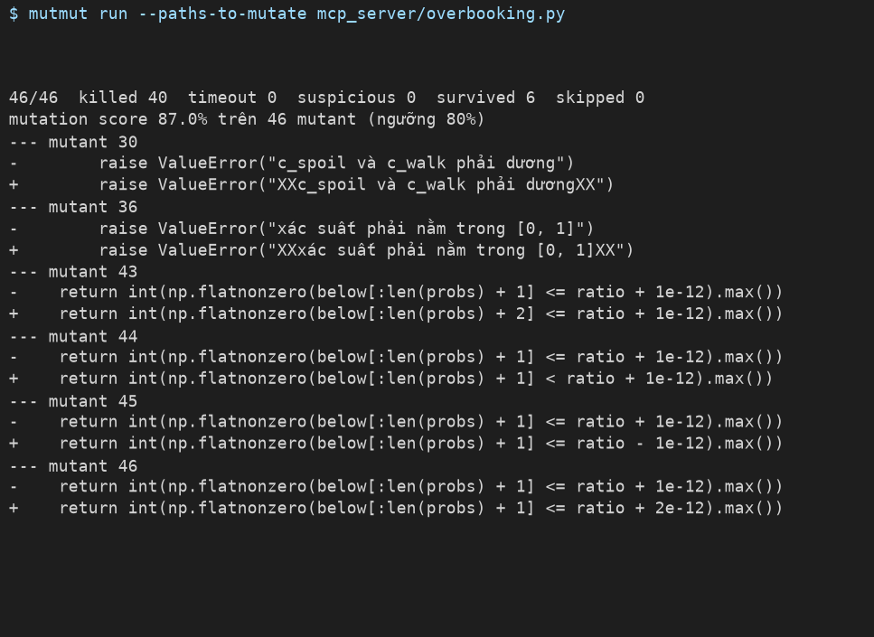

# Validation & verification

Unit test, phân lớp tương đương và giá trị biên (EP/BVA), mutation test, property-based test và load test.

Mỗi mục ứng với một dòng của rubric. Mục đã hoàn thành gồm phần **Thực thi** (đã làm gì, chạy ở đâu) và **Kết quả**
(số liệu đo được, ảnh chụp trong `docs/images/`). Mục chưa hoàn thành giữ trích rubric và phần **Cách làm** đồng bộ từ
cột F của rubric.

## Unit test với Test Coverage > 90% · edai-2 · Validation & Verification

**Thực thi:** `edai2/tests/test_server.py` và `edai2/tests/test_cancel_risk.py` kiểm Web API của booking-mcp bằng
fixture, monkeypatch và respx (giả Feast và KServe); `edai2/tests/test_overbooking.py` kiểm hàm tính K.

**Kết quả:** chạy cục bộ ngày 2026-11-18: 51 test đạt, coverage `mcp_server/server.py` 95% và `overbooking.py` 100%.
Phần này chưa có ảnh chụp trên cluster.

## Có sử dụng kỹ thuật equivalence partitioning vs boundary value analysis khi thiết kế test… · edai-2 · Validation & Verification

**Thực thi:** test tham số hoá theo các lớp tương đương và giá trị biên: xác suất trong [0, 1] trả về từ KServe,
`booking_id`, và K (p = 0 hoặc 1, không có booking, chi phí ≤ 0). `tests/test_overbooking.py` dùng hypothesis để so K
với định nghĩa trực tiếp.

**Kết quả:** các test `edai2/tests/test_overbooking.py` chạy cục bộ và đạt (2026-11-16). Phần này chưa có ảnh chụp trên
cluster.

## Có sử dụng mutation testing để đánh giá hiệu quả của các test · edai-2 · Validation & Verification

**Thực thi:** Jenkins chạy mutmut chỉ trên các file thay đổi; `ci/check_mutation_score.py` chặn build khi score dưới
80%.

**Kết quả:** mutmut chạy cục bộ ngày 2026-11-18 trong container `python:3.12-slim` với `requirements-dev.txt`, chỉ mutate
`mcp_server/overbooking.py` (file có logic thay đổi gần nhất); bước này chưa chạy trong pipeline Jenkins. Trong 46 mutant,
test giết 40 và để sống 6, **mutation score đạt 87,0%** (ngưỡng 80%). Cả 6 mutant sống sót không làm đổi hành vi của `limit`:

- 2 mutant chỉ đổi chuỗi thông báo của `ValueError`.
- 2 mutant đổi epsilon `1e-12` thành `-1e-12` hoặc `2e-12`; mức chênh này quá nhỏ để làm đổi K.
- Mutant `len(probs) + 2` lấy thêm phần tử cuối của `below` (bằng 1). Hai chi phí đều dương nên `ratio` < 1, phần tử này
  không thoả điều kiện và kết quả giữ nguyên.
- Mutant thay `<=` bằng `<` chỉ khác khi `P(N < k)` bằng đúng `ratio + 1e-12`; bộ test không có trường hợp nào như vậy.

## Idempotency testing sử dụng property-based testing · edai-2 · Validation & Verification

**Thực thi:** Hypothesis kiểm hai property: `test_predict_tool_idempotent` (tool MCP) và `test_cancel_risk_idempotent`
(REST). Cùng một booking gọi hai lần phải cho cùng kết quả.

**Kết quả:** chạy cục bộ ngày 2026-11-18 (`pytest tests/ -k idempotent --hypothesis-show-statistics`): 2 test property
đều đạt, mỗi test 50 ví dụ do Hypothesis sinh (`booking_id` và xác suất KServe giả trả về trong [0, 1]), 0 ví dụ lỗi.
`test_cancel_risk_idempotent` gọi handler REST `cancel_risk` (`POST /v1/cancel-risk`) hai lần; `test_predict_tool_idempotent`
gọi tool MCP `predict_cancellation` hai lần cho cùng booking. Cả hai kiểm hai lần gọi cho cùng kết quả; Feast và KServe
được giả bằng respx.

## Load test the Web API to understand throughput and latency · edai-2 · Validation & Verification

**Rubric:** edai-2 · dòng 32 · 2 điểm · nhóm *Validation & Verification*

> Local Testing Load test the Web API (cái Web API kéo dữ liệu) to understand throughput (req/s) and latency (generate a html file with locust as SLA)

**Cách làm:** [Đã có] `tests/locustfile.py` gửi tải tới `POST /v1/cancel-risk` của booking-mcp. [Cần làm] chạy với `--html`, chụp RPS và p95.

**Kết quả:** _Chưa có. Cần số liệu, ảnh chụp hoặc link code sau khi chạy trên cluster._
