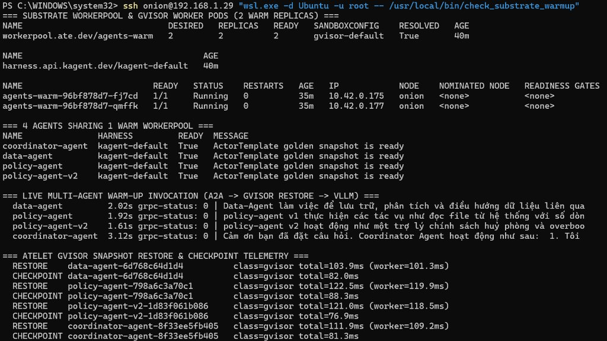

# Warm-up (Agent Substrate)

Giữ sẵn worker cho agent để giảm chi phí và độ trễ khởi động.

## Chế độ Warm-up cho agent (Agent Fleet Architecture)

Hệ thống đã triển khai chế độ Warm-up theo mô hình **Agent Fleet** của Agent Substrate tại [agent-substrate-v1.yaml](../../edai2/k8s/agent-substrate-v1.yaml):

- **Pool worker warm dùng chung (`WorkerPool/agents-warm`):** duy trì sẵn `2/2 Ready` worker gVisor, kết hợp RustFS (`s3://ate-snapshots`) lưu golden snapshot và actor checkpoint.
- **Chia sẻ tài nguyên giữa các agent:** cả 4 agent (`data-agent`, `policy-agent`, `policy-agent-v2`, `coordinator-agent`, đều `Ready=True`) chạy ghép kênh trên đúng 2 worker pod thay vì cấp Deployment riêng cho từng agent.
- **Đo đạc thực tế qua A2A:** thời gian khôi phục (restore) actor từ snapshot chỉ mất **`103,9–122,5 ms`**, checkpoint sau lượt chạy mất **`76,9–88,3 ms`**, và tổng thời gian phản hồi end-to-end đạt `1,61–3,12 s`.

*Chú thích: Kết quả đo thực tế mô hình Agent Fleet Warm-up trên 2 worker pod gVisor (`agents-warm`): cả 4 agent dùng chung 2 worker, khôi phục actor từ snapshot RustFS chỉ mất `103,9–122,5 ms` và checkpoint `76,9–88,3 ms`.*
